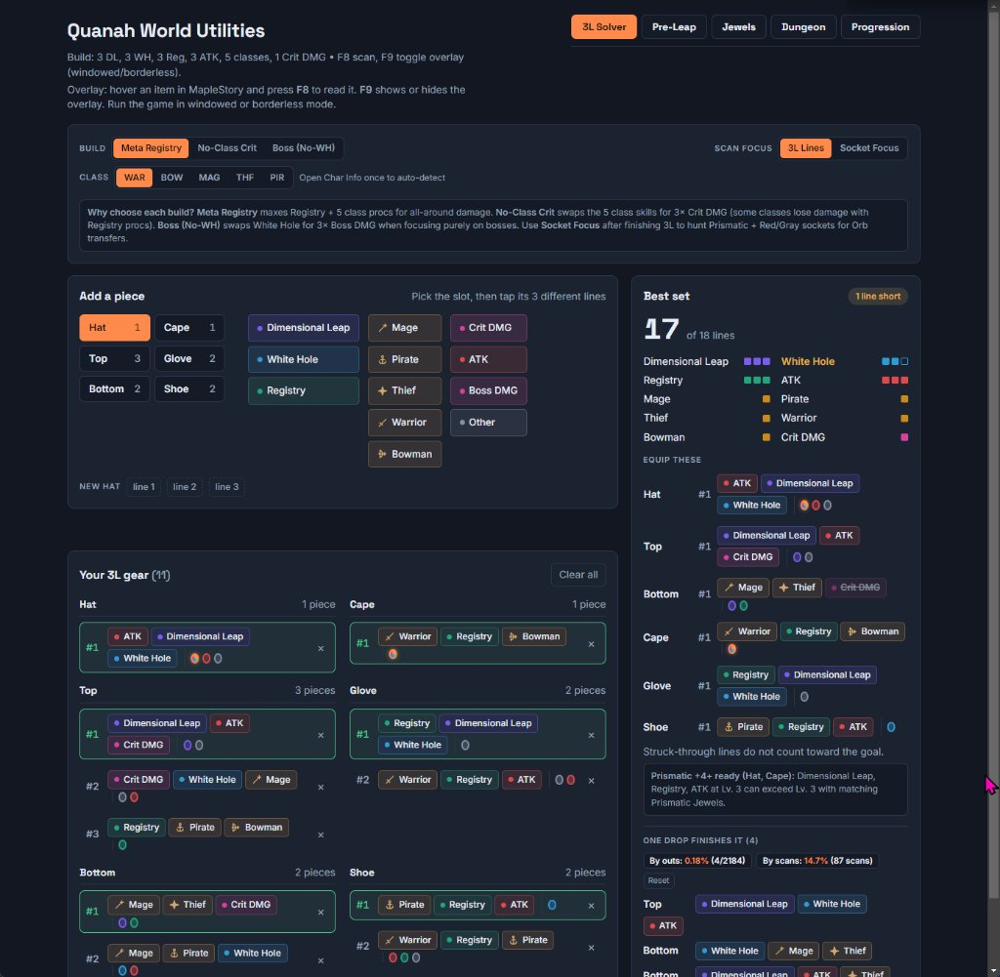
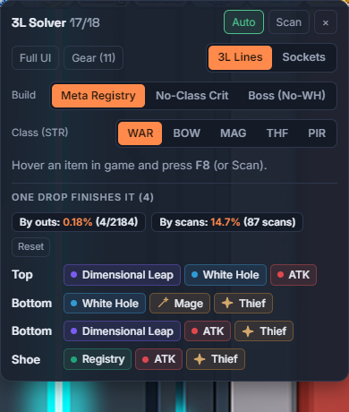
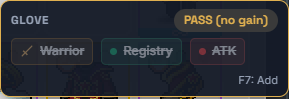
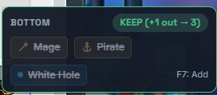

# Quanah World Utilities (v0.4.0)

A desktop overlay, real-time item scanner, and progression companion for **MapleStory Quanah World**.

---

## Download & Web Tool

- **Web Tool (No Download):** **[Open Quanah World Utilities Web App](https://altord.github.io/QuanahWorldUtilities/)**
  - Includes all manual calculators, guides, and trackers (**3L Solver**, **Drop Log**, **Guide**, **Pre-Leap**, **Jewels**, **Crystals**, **Dungeon**, **Progression**), or open `Quanah World Utilities.htm` locally.
  - **Note:** The **in-game overlay, cursor HUD, Auto-Add, and screen OCR scanner do not work in a web browser** — browsers cannot capture the game screen or draw over MapleStory. Use the Windows Desktop App below if you want live in-game scanning.
- **Desktop App (with In-Game Overlay & Scanner):** Download from **[Releases](https://github.com/Altord/QuanahWorldUtilities/releases)** (no Administrator privileges required):
  - `Quanah World Utilities 0.4.0.exe` — Portable standalone `.exe` (double-click to run, no installation needed).
  - `Quanah World Utilities Setup 0.4.0.exe` — Standard Windows installer.

> **Important:** Run MapleStory in **Windowed** or **Borderless** mode so the overlay and cursor HUD can render on top of the game.

---

## How It Works

### 1. Main Workbench (`3L Solver` & `Socket Focus`)

- **Top Controls Bar:**
  - **Build:** Switch between **Meta (Post-Nerf)** (`18L` — 3 DL, 3 WH, 3 Reg, 3 ATK, 3 Crit DMG, 3 Damage; drops the nerfed -30% class hologram skills), **Legacy Registry** (`18L` — pre-nerf 5-class setup), **No-Class Crit (15)** (`15L` — 3 flex lines), and **Boss (No-WH)** (`18L` — swaps White Hole for 3× Boss DMG).
  - **Scan Focus:** Switch between **3L Lines** (solving your 6-slot hologram lines), **Socket Focus** (finding BiS jewel sockets for Orb transfers), and **3L + Sockets** (combined solver).
  - **Class (`WAR | BOW | MAG | THF | PIR`):** Filters out wrong-job gear you can't equip and sets your class's matching jewel colors (`STR` = Red/Green/Gray, `DEX` = Red/Green/Gray/Purple, `LUK` = Purple/Gray, `INT` = Blue). You can also open **Character Info** in-game once to auto-detect your class.
- **Add a piece & Your 3L gear:** Add pieces manually or via the in-game scanner, with a collapsible **Expand 3L Gear** drawer. Saved pieces show both their 3 hologram lines and their detected jewel socket icons (Prismatic, Red, Green, Gray, Purple, Blue).
- **Best set & Orb Transfer Plan:** Calculates the optimal 1-piece-per-slot loadout, flags **Prismatic +4+ ready** slots, tracks slot-by-slot **Orb Transfer Plan** readiness (`0 Orb ✓` vs `1 Orb` vs missing socket/3L), and lists **One drop finishes it** or **Pieces to look out for** with **By outs** and **By scans** probabilities.
- **Header Backup / Restore:** Export or import all saved gear, Drop Log, Jewels, and Guide progress as JSON.

---

### 2. In-Game Overlay

- Stays on top of MapleStory in the corner without stealing focus (no Admin privileges needed).
- **Auto-Add Modes (`Off | Any | 3/3 Build | +Gain/Outs | 3/3+Gain`):**
  - **`Off`** — Hover to preview only; click **Add** (or press `F7`) to save.
  - **`Any`** — Adds every valid item for your class (even with `Other`/unused lines).
  - **`3/3 Build`** — Fastest for **18/18**; banks every clean 3-line piece (no `Other` lines) so future slot combos aren't missed.
  - **`+Gain/Outs`** — Saves any item that immediately raises your score or 1-drop outs.
  - **`3/3+Gain`** — Best near **18/18**; saves only clean 3-line pieces that also raise score/outs now.
- **Hotkeys:**
  - **`F8`** — Scan the item tooltip under your cursor (or leave **Auto** on to scan automatically on hover).
  - **`F7`** — Quick-add the currently hovered item (when not blocked by an elevated game window; use **Auto-Add** otherwise).
  - **`F9`** — Show or hide the overlay.
- Click **`Full UI`** to bring up the main window, **`Gear (N)`** to inspect/remove saved pieces right inside the overlay, or **`3L Lines | Sockets`** to swap modes on the fly.

---

### 3. Floating Cursor HUD (Instant Keep / Pass Readout)

When you hover over an item in your inventory, a compact click-through badge appears right above the tooltip and disappears as soon as you move your cursor away:

| What you see | Meaning |
| --- | --- |
|  | Shows the detected slot (`TOP`), verdict, and the 3 lines right next to your cursor. |
|  | **`ALREADY OWNED`** — You already have this exact 3-line (or 3-socket) piece saved, preventing duplicate adds. |
|  | **`PASS (no gain)`** — Doesn't improve your set score or add new 1-drop outs (you can still press `F7` if you want to store it). |
|  | **`KEEP (+1 out → 3)`** — Even if it doesn't raise your score right away, keeping it opens up more **One drop finishes it** combinations. |

- Hovering a piece that **finishes your set (`18/18` or `15/15`)** triggers a rainbow **`★ FINISHES SET! ★`** HUD border with spark particles.
- Hovering gear for another job (e.g. a Thief piece while set to `WAR`) flags **`WRONG JOB`** and ignores it.

---

### 4. Quanah World Utilities & Guide Tabs

- **`Drop Log`:** Auto-logs every scanned 3L drop (on-class & off-class, 1-minute per-piece cooldown) with session `Drops/hr` timer, class/slot/line frequency tables, **Empirical Quanah Orb Drop Rate Tracker** (Dungeon Boss Chests + Proving Fields), and 1-click Reddit/Discord Markdown & CSV export.
- **`Guide`:** Persistent character dashboard (`Lv.`, `CP (M)`, `Drop %`, Class, `Drop Fam`) with 6 sub-tabs: **Roadmap**, **CP Priority** (#1–#6 playbook), **Item Targets** (slot-by-slot gear stat cheat sheet + live Flame Score checker), **Bosses** (28-boss ladder + Pass Advisor), **Farming** (Proving Fields `1-1` to `3-3` + all Orb drop locations), and **BiS Jewels**.
- **`Pre-Leap`:** 18-item Challenger World 4 checklist, Lv. 260/264 Sacred Symbol calculator, and **Post-Quanah World Leap Exit Checklist** (22★ permanent gear cap & Mar 9, 2027 deadline).
- **`Jewels` (+ Jewel Helper Overlay):** Valid socket colors by main stat (`STR` = Red/Green/Gray, `DEX` = Red/Green/Gray/Purple, `LUK` = Purple/Gray, `INT` = Blue), exact 18-jewel shopping list, 6-skill Prismatic Lv. 1–8 Final Damage calculator, Jewel leveling & 1-Fuse Dust calculators, and live tooltip scanner.
- **`Crystals`:** Quanah Crystal cost & roll estimators for **Potential**, **Star Force** (Markov solver with Safeguard & 30% Off / 5/10/15), and **Bonus Stats (Flames)**.
- **`Dungeon` (+ Dungeon Helper Overlay):** 5-room flow, pre-entry buff checklist (with auto buff-bar detection), live **Select Code** & Overclocked Fusion analyzer, Weekly Projected Power tracker, and Dungeon vs. Proving Fields Orb drop locations.
- **`Progression`:** Inspector 3-Pass Skill Inheritance planner (`Lv. 50 / 80 / 100`, Grade 1–5), interactive **Mapae Module** (`Red → Green → Blue`) tracker, Dimensional Skills tier list, and 22★ Inspector's Mapae Badge tracker.

---

## Credits & Sources

- **[The Quanah Files](https://docs.google.com/document/d/1X2P51gaWxZ_Ltxr466CEH26pK9OouXyDT5rOdbYxOhE/edit?tab=t.0)** by **PiercedMoon** — Primary Quanah World progression, Hologram, Jewel, Dungeon, Inspector, and Mapae guide.
- **BlackHexgon** (on Discord) — Community info & contributions.
