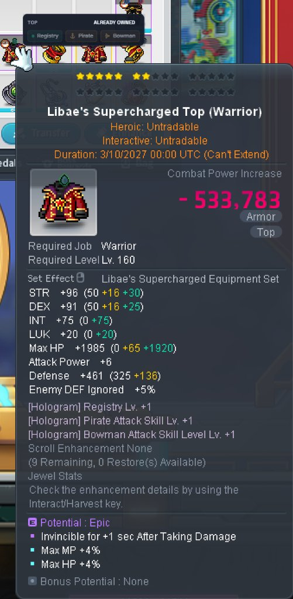
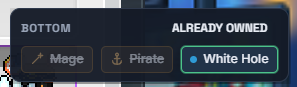

# Quanah World Utilities (v0.1.4)

A desktop overlay, real-time item scanner, and progression companion for **MapleStory Quanah World**.

---

## Download & Web Tool

- **Web Tool (No Download):** **[Open Quanah World Utilities Web App](https://altord.github.io/QuanahWorldUtilities/)**
  - Includes all manual calculators and guides (**3L Solver**, **Socket Focus**, **Pre-Leap**, **Jewels**, **Dungeon**, **Progression**).
  - **Note:** The **in-game overlay, cursor HUD, Auto-Add, and screen OCR scanner do not work in a web browser** — browsers cannot capture the game screen or draw over MapleStory. Use the Windows Desktop App below if you want live in-game scanning.
- **Desktop App (with In-Game Overlay & Scanner):** Download from **[Releases](https://github.com/Altord/QuanahWorldUtilities/releases)** (no Administrator privileges required):
  - `Quanah World Utilities 0.1.4.exe` — Portable standalone `.exe` (double-click to run, no installation needed).
  - `Quanah World Utilities Setup 0.1.4.exe` — Standard Windows installer.

> **Important:** Run MapleStory in **Windowed** or **Borderless** mode so the overlay and cursor HUD can render on top of the game.

---

## How It Works

### 1. Main Workbench (`3L Solver` & `Socket Focus`)

- **Top Controls Bar:**
  - **Build:** Switch between **Meta Registry** (`18L` — 3 DL, 3 WH, 3 Reg, 3 ATK, 5 classes, 1 Crit DMG), **No-Class Crit** (`15L` — swaps the 5 class skills for 3× Crit DMG), and **Boss (No-WH)** (`18L` — swaps White Hole for 3× Boss DMG).
  - **Scan Focus:** Switch between **3L Lines** (solving your 6-slot hologram lines) and **Socket Focus** (finding BIS jewel sockets for Orb transfers).
  - **Class (`WAR | BOW | MAG | THF | PIR`):** Filters out wrong-job gear you can't equip and sets your class's matching jewel colors. You can also open **Character Info** in-game once to auto-detect your class.
- **Add a piece & Your 3L gear:** Add pieces manually or via the in-game scanner. Saved pieces show both their 3 hologram lines and their detected jewel socket icons (Prismatic, Red, Green, Gray, Purple, Blue).
- **Best set:** Calculates the optimal 1-piece-per-slot loadout, flags **Prismatic +4+ ready** slots when equipped pieces have a Prismatic socket and Lv. 3 stats, and lists every **One drop finishes it** combination with **By outs** (single-drop %) and **By scans** (cumulative % across unique scans).

---

### 2. In-Game Overlay

- Stays on top of MapleStory in the corner without stealing focus (no Admin privileges needed).
- **Auto-Add Modes (`Off | Any | 3/3 Build | +Gain/Outs | 3/3+Gain`):**
  - **`Off`** — Hover to preview only; click **Add** (or press `F7`) to save.
  - **`Any`** — Adds every valid item for your class (even with `Other`/unused lines).
  - **`3/3 Build`** — Fastest for **18/18**; banks every clean 3-line piece (no `Other` lines) so future slot combos aren't missed.
  - **`+Gain/Outs`** — Saves any item that immediately raises your score or 1-drop outs.
  - **`3/3+Gain`** — Best near **18/18**; saves only clean 3-line pieces that also raise score/outs now.
- **Hotkeys:**
  - **`F8`** — Scan the item tooltip under your cursor (or leave **Auto** on to scan automatically on hover).
  - **`F7`** — Quick-add the currently hovered item (when not blocked by an elevated game window; use **Auto-Add** otherwise).
  - **`F9`** — Show or hide the overlay.
- Click **`Full UI`** to bring up the main window, **`Gear (N)`** to inspect/remove saved pieces right inside the overlay, or **`3L Lines | Sockets`** to swap modes on the fly.

---

### 3. Floating Cursor HUD (Instant Keep / Pass Readout)

When you hover over an item in your inventory, a compact click-through badge appears right above the tooltip and disappears as soon as you move your cursor away:

| What you see | Meaning |
| --- | --- |
|  | Shows the detected slot (`TOP`), verdict, and the 3 lines right next to your cursor. |
|  | **`ALREADY OWNED`** — You already have this exact 3-line (or 3-socket) piece saved, preventing duplicate adds. |
|  | **`PASS (no gain)`** — Doesn't improve your set score or add new 1-drop outs (you can still press `F7` if you want to store it). |
|  | **`KEEP (+1 out → 3)`** — Even if it doesn't raise your score right away, keeping it opens up more **One drop finishes it** combinations. |

- Hovering a piece that **finishes your set (`18/18` or `15/15`)** triggers a rainbow **`★ FINISHES SET! ★`** HUD border with spark particles.
- Hovering gear for another job (e.g. a Thief piece while set to `WAR`) flags **`WRONG JOB`** and ignores it.

---

### 4. Quanah World Guide Tabs

- **`Pre-Leap`:** 18-item Challenger World 4 checklist (Lv. 260/264 Sacred Symbol timing, drop accessories, Arcane Symbols, auto-buff pets).
- **`Jewels`:** Full Jewel Color table (`Red`/`Gray` = STR, `Green` = DEX, `Purple` = LUK, `Blue` = INT) and Prismatic Lv. 4+ rules.
- **`Dungeon`:** 5-room dungeon formula, Dungeon Storage early-exit tips, buffs/fatigue, and Dungeon vs. Proving Grounds drop tables.
- **`Progression`:** Inspector Level & death-inheritance milestones (Lv. 50 / 80 / 100), Mapae Module & Inspector Badge tips, Starforce/Bossing rules, Hologram Skills reference, and Known Bugs.
